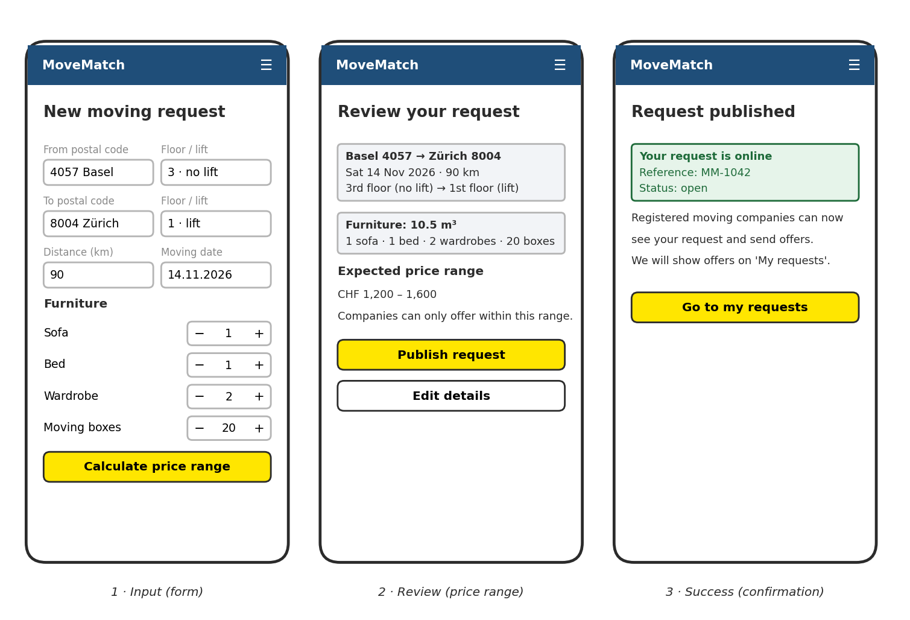
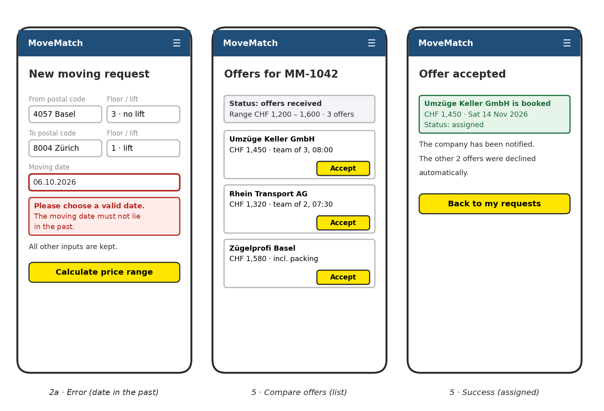
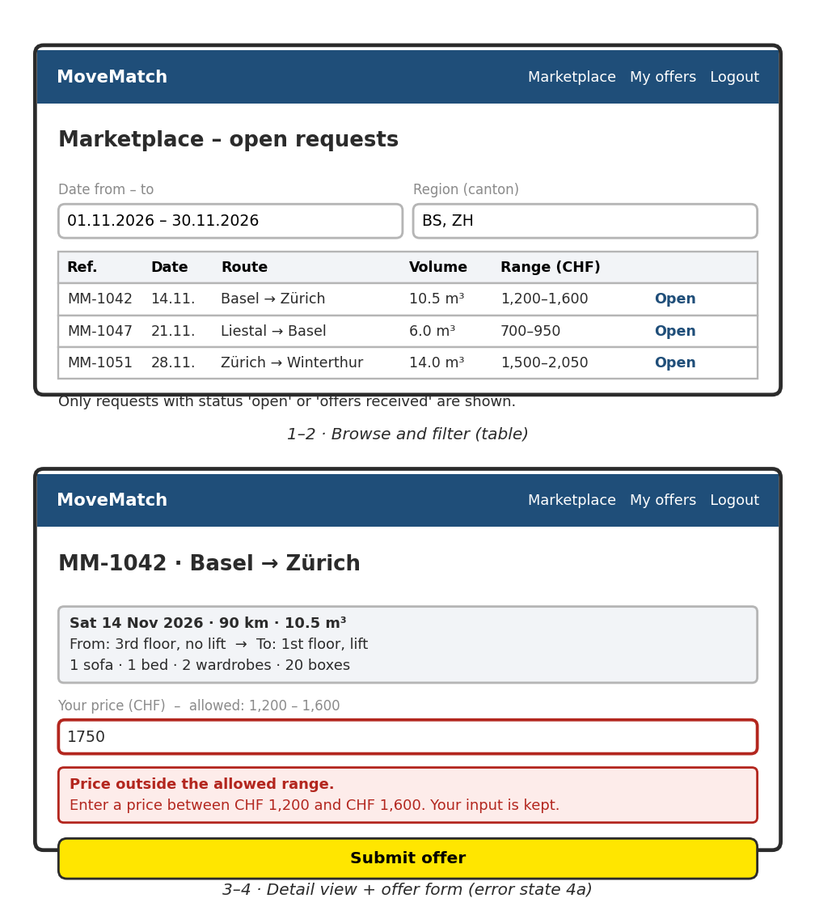
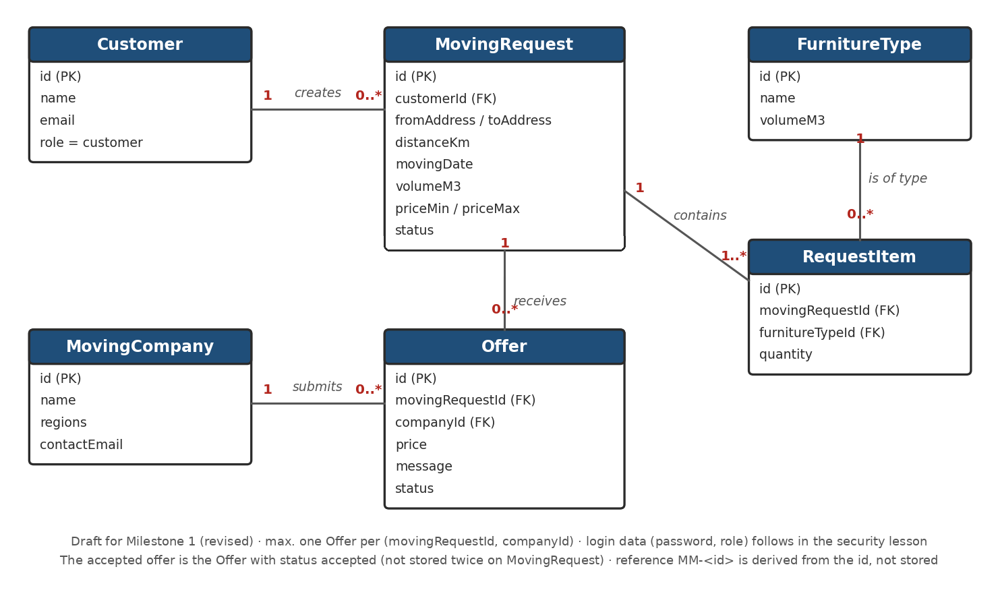

# MoveMatch

**Current stage:** Milestone 2 — OpenAPI contract and first implemented part of the backend (offers: submit and withdraw). The design from Milestone 1 was revised after the design coaching (see [Changes after the design coaching](#changes-after-the-design-coaching-5-october)). This README is updated throughout the project; we do not start a separate document for each milestone.

The backend is **not complete**: only the first workflow slice is implemented (see [Implementation](#4-implementation)). All other operations are planned in the contract. The frontend, login and the database come in later milestones.

## Project overview

MoveMatch is a web marketplace for private moves. Today, people who move contact five to ten moving companies one by one, fill in a different form each time and wait for replies. Many companies have no capacity on the requested date, and the quotes are hard to compare because each company asks for different details. Companies, in turn, lose time on incomplete requests.

With MoveMatch, a customer describes the move **once** in a standard form (addresses, distance, date, floor, lift and the number of specific furniture items). The application calculates a price range that leaves room for negotiation and publishes the request on a marketplace. Registered moving companies browse the requests, submit one offer within the range, and the customer accepts the offer that fits best.

**Intended users:** private customers who are planning a move, and dispatchers of small and medium moving companies.

### Team and responsibilities

| Member | Responsibility in Milestone 2 | Files | Next action |
|---|---|---|---|
| Blenoard | README, persistence and seed data | `README.md`, `movematch/storage.py`, `movematch/seed.json` | Submit the repository link in Moodle; join the Teams channel; record the coaching feedback |
| Younes   | Business rules (application logic) and behaviour tests | `movematch/service.py`, `tests/test_api.py` | Add the next rules (7: accept an offer, 8: edit/delete a request) with tests |
| Leutrim  | HTTP interface and project setup | `movematch/api.py`, `movematch/models.py`, `movematch/main.py`, `requirements*.txt`, `pytest.ini`, `.gitignore` | Add the next endpoints (list offers of a request, accept an offer) |
| Salahdin | OpenAPI contract and contract test | `contracts/movematch.openapi.yaml`, `tests/test_contract.py`, `data/*.json` | Keep the contract and the implementation reconciled; set more operations to `implemented` / `tested` |

These are starting responsibilities, not permanent silos. Everyone reviews the whole project and should be able to explain it in coaching. Code was drafted with AI assistance (see References) and is reviewed by the person responsible for the file.

## 1. Analysis

### Scenario, users and goals

- **Situation or problem:** A person moving from Basel to Zürich has to contact many companies, repeat the same information in different forms and compare quotes that are based on different assumptions. Moving companies receive incomplete enquiries and requests for dates on which they are already fully booked.
- **Intended users:**
  - *Customer* (e.g. Lena, private person): wants to describe the move once and receive comparable offers.
  - *Moving company* (e.g. the dispatcher of Umzüge Keller GmbH): wants complete, comparable requests to fill free days in the schedule.
  - *Admin*: optional, later (e.g. company verification).
- **Proposed benefit:** one standard request instead of ten; offers only from companies with capacity; comparable offers within a transparent price range; less time spent on incomplete enquiries.
- **Initial scope:** Workflow A (customer publishes a request) and Workflow B (company submits an offer), plus accepting an offer.
  - *Left out for now:* online payment (needs a payment provider and legal checks), chat or live negotiation (the price range covers negotiation), automatic distance via a maps API (customers enter postal codes and an approximate distance), reviews and ratings (only useful once real moves happened), company verification (we assume registered companies are legitimate).

### User stories and first workflow

**Customer**

- As a customer, I want to describe my move once in a standard form, so that I do not have to fill in a different form for every company.
- As a customer, I want to see an expected price range before publishing, so that I know what the move will roughly cost.
- As a customer, I want to compare offers and accept one, so that my move is booked with a company that has capacity on my date.
- As a customer, I want to delete my request as long as no offer is accepted, so that companies stop sending offers if my plans change.

**Moving company**

- As a dispatcher, I want to filter open requests by date and region, so that I only see jobs that fit our free days.
- As a dispatcher, I want to see all details of a request (floors, lift, furniture), so that I can make a realistic offer without calling back.
- As a dispatcher, I want to submit an offer within the price range, so that the customer can compare it fairly with other offers.
- As a dispatcher, I want to withdraw an offer that is still pending, so that I am not bound to a price if we can no longer do the job.

**Workflow A — customer publishes a moving request (Lena, Basel → Zürich)**

| Step | User / role | Action | Information needed | Expected result or feedback |
|---|---|---|---|---|
| 1 | Customer | Enter the move details | From/to postal code and city, floor, lift, distance (km), moving date, quantity of sofas, beds, wardrobes and boxes | Input is kept ready to submit |
| 2 | Customer | Submit the form ("Calculate price range") | The entered data | Required fields checked; moving date not in the past |
| 3 | Customer | Review the summary | — | Route, date, volume (10.5 m³) and price range (CHF 1,200–1,600) are shown |
| 4 | Customer | Publish the request | Confirmation | Request saved with status `open` and reference MM-1042 (the reference is built from the request ID 1042); listed on the marketplace |
| 5 | Customer | Open the offers and accept one (after confirming) | Chosen offer | Request `assigned`; chosen offer `accepted`; all other offers `declined`; the company sees the result under "My offers" |
| 2a | Customer | Submit with a date in the past (e.g. 06.10.2026) | — | Message explains that the date must not be in the past; other input is kept; no request is created |

**Workflow B — moving company submits an offer (Umzüge Keller GmbH)**

| Step | User / role | Action | Information needed | Expected result or feedback |
|---|---|---|---|---|
| 1 | Company | Open the marketplace | — | Open requests with date, route, volume and price range |
| 2 | Company | Filter by date and region | Date range, cantons | Only matching requests are shown |
| 3 | Company | Open one request | — | All details and the allowed price range |
| 4 | Company | Enter a price and submit the offer | Price (CHF), optional message | Price checked against the range; check that the company has no other offer on this request |
| 5 | Company | Read the confirmation | — | Offer saved as `pending`; request changes to `offers_received` |
| 6 | Company | Withdraw a pending offer (under "My offers") | Confirmation | Offer is deleted; if it was the last pending offer, the request returns to `open` |
| 4a | Company | Enter CHF 1,750 (above the range) | — | Allowed range is shown; input kept; offer not saved |

**Questions and exceptions worth discussing**

- *A company cannot do the job after its offer was accepted (e.g. the truck breaks down a week before).* Draft decision: an accepted offer is binding, and cancelling after the assignment is not part of version 1. If this becomes a problem, a reliability rating of companies (as known from marketplaces) is a possible later extension.
- *The customer clicks "Accept" on an offer that the company withdrew in the meantime.* The application shows an error, nothing changes, and the list of offers is refreshed. Offers cannot be edited, so no customer can accept a price that has silently changed.
- *The customer notices more furniture after offers arrived.* Draft decision: editing is only allowed while the request is `open`; afterwards the customer deletes the request and creates a new one.

## 2. Design

### Screens and navigation

Digital versions of our sketches:


*Workflow A on a phone: the form, the review with the price range and the confirmation are states of one "new request" flow.*


*Error state 2a (date in the past, other input kept), the list of offers as cards, and the confirmation after accepting.*


*Workflow B on a desktop: the marketplace table with filters, and the request detail with the offer form in error state 4a.*

**Main inputs, actions and feedback**

- Customers mostly use a **phone**: one column, +/− steppers for furniture, a highlighted price range, buttons with clear verbs ("Calculate price range", "Publish request").
- Dispatchers mostly use a **desktop**: a table to compare many requests, filters for date and region, a price field labelled with the allowed range.
- Errors appear directly at the affected field, explain how to fix the problem and keep all other input. Accepting an offer needs a confirmation because it cannot be undone.

**Navigation (draft)**

| View | Role | Main actions |
|---|---|---|
| Start page | Visitor | Explains how MoveMatch works; log in / register (later) |
| My requests | Customer | Open a request; create a new request |
| New request (form → review → confirmation) | Customer | Calculate range; edit; publish |
| Request detail with offers | Customer | Accept an offer; delete the request |
| Marketplace | Company | Filter; open a request |
| Request detail + offer form | Company | Submit an offer |
| My offers | Company | See the status of own offers; withdraw a pending offer |

A clickable prototype (Bootstrap Studio) is planned but not yet available. The frontend technology is still undecided.

### Domain concepts and example data

All example data is fictional.

| File | Content |
|---|---|
| [`data/furniture-types.json`](data/furniture-types.json) | Catalogue of furniture types with their volume in m³ |
| [`data/create-moving-request.json`](data/create-moving-request.json) | What the customer sends when creating a request |
| [`data/price-estimate.json`](data/price-estimate.json) | How the price range for this request is calculated |
| [`data/moving-request.json`](data/moving-request.json) | The saved request as the app returns it |
| [`data/moving-company.json`](data/moving-company.json) | A registered moving company |
| [`data/create-offer.json`](data/create-offer.json) / [`data/offer.json`](data/offer.json) | An offer as sent by the company and as saved |
| [`data/error-examples.json`](data/error-examples.json) | Planned error responses for the main business rules (each entry names the rule it belongs to) |



**Important fields and types**

- `movingDate` is a string in ISO format (`"2026-11-14"`), because JSON has no date type; the backend converts it to check that the date is not in the past.
- `fromAddress` / `toAddress` are objects, because postal code, floor and lift are used separately (region filter, floor surcharge).
- `items` is an array of `{ "furnitureTypeId", "quantity" }`. Each item **refers** to the furniture catalogue by ID instead of a name, so that names can change and the volume is defined in one place. The quantity belongs to the item, not to the furniture type.
- Units are part of the key name (`distanceKm`, `volumeM3`); prices are whole CHF with a separate `currency` field.
- The reference `MM-1042` is only a display format: it is built from the request ID (`"MM-"` + ID) and returned as a read-only field `reference`. It is not stored separately, so it cannot disagree with the ID.
- An offer references its request (`movingRequestId`) and company (`companyId`). There is no `acceptedOfferId` on the request: the accepted offer is the offer of that request with status `accepted` (at most one per request). Storing it in both places would allow the two to disagree.
- `customerId` and `companyId` are not sent by the client. They belong to the logged-in user (login follows in the security lesson; until then a fixed demo user is possible — to be decided).
- Status values: request `open`, `offers_received`, `assigned`, `completed`; offer `pending`, `accepted`, `declined`. A deleted request or offer is really removed, so there is no `withdrawn` status.

### Business rules and possible operations

**Rules (draft)**
1. The moving date must not lie in the past (today is allowed).
2. Quantities are whole numbers ≥ 0, and at least one item has a quantity ≥ 1.
3. The price range is calculated as estimate ± 15 %, rounded inwards to CHF 50. Draft estimate: base price CHF 350 + CHF 3 per km + CHF 60 per m³ + CHF 50 per floor without lift. Lena's move: 350 + 270 + 630 + 150 = CHF 1,400 → range CHF 1,200–1,600.
4. A company offer must lie within the range of the request (both limits included).
5. A company can have only one offer per request at a time. It can withdraw a pending offer and submit a new one.
6. Offers are only possible while the request is `open` or `offers_received`.
7. A customer can only accept a `pending` offer of a request that is not yet `assigned`. Accepting is one step: the offer becomes `accepted`, all other offers of the request become `declined` and the request becomes `assigned`. A request never has more than one accepted offer.
8. A request can only be edited while it is `open`, and deleted as long as it is not `assigned`. Deleting really removes the request together with its pending offers.
9. An offer cannot be edited. A company can withdraw (delete) its own offer while it is `pending`; if it was the last pending offer, the request returns to `open`. An accepted offer is binding and cannot be withdrawn.
10. An `assigned` request becomes `completed` automatically once its moving date has passed. Nobody sets this status manually in version 1.

The frontend checks rules 1, 2 and 4 early for better feedback, but the backend service logic is the authority, because the API can also be called without our frontend. Where each rule is enforced is documented in [Implementation](#4-implementation).

| User goal | Proposed action | Example input | Expected output | Open question |
|---|---|---|---|---|
| Publish a move | Create a moving request | `data/create-moving-request.json` | Saved request with ID (shown as reference MM-1042), volume, price range, status `open` | Is a manual distance acceptable? |
| Find suitable jobs | Read open requests (with filters) | Date range, region | List of requests with date, route, volume, range | Filter by canton or by postal code range? |
| Inspect a job | Read one request | Request ID 1042 | All details incl. range; no contact data before acceptance | — |
| Correct a mistake | Change a request | Changed furniture list | Updated request and recalculated range — only while `open`, otherwise a conflict error | — (decided: no changes once offers exist) |
| Cancel a move | Remove (delete) a request | Request ID | Request and its pending offers are deleted — only while not `assigned`, otherwise a conflict error | — (decided: real delete) |
| Make an offer | Create an offer | `data/create-offer.json` | Offer `pending` — or error: outside range / already offered / request no longer accepts offers | — (decided: offers cannot be edited) |
| Withdraw an offer | Remove (delete) an offer | Offer ID | Offer deleted — only while `pending`; a conflict error once it is accepted | — |
| Compare offers | Read offers of my request | Request ID | List of offers with company, price, message | Sort by price only? |
| Book a company | Accept an offer | Offer ID 311 | Offer `accepted`, request `assigned`, others `declined` — or error if the offer no longer exists or the request is already assigned | `PATCH` status or explicit action endpoint? |

These are the ideas in plain language. The contract with the concrete endpoints is [`contracts/movematch.openapi.yaml`](contracts/movematch.openapi.yaml); the status of each operation is in [Implementation](#4-implementation). The planned error responses are in [`data/error-examples.json`](data/error-examples.json).

## 3. Project management

### Decisions, open questions and next steps

| Question / decision | Current position | Next step |
|---|---|---|
| Scope of version 1 | Decided: Workflows A and B plus accepting an offer; payment, chat, maps API, reviews and verification are out | Confirm in the backend coaching (26 Oct) |
| Moving date | Decided: the date must not lie in the past (earlier draft: 7 days minimum lead time, dropped) | Implement as input validation when creating requests (planned, Workflow A) |
| Request reference | Decided: `MM-<ID>` is built from the request ID and not stored | Done: read-only field `reference` in the contract and the API |
| Deleting a request | Decided: real delete while not `assigned`; its pending offers are deleted with it | Implement in Milestone 2 (including the related offers) |
| Changing or withdrawing an offer | Decided: offers cannot be edited; a pending offer can be withdrawn (deleted) and replaced by a new one; an accepted offer is binding; accepting an offer that no longer exists gives an error | Done for withdrawing and creating offers (rules 5, 6, 9); accepting follows |
| Accepted offer | Decided: no `acceptedOfferId` on the request; the accepted offer is the offer with status `accepted` | Done in the data model draft |
| Who sets a request to `completed`? | Decided: automatically after the moving date has passed; no manual step | Choose the technical approach in Milestone 2 (e.g. derive it when the request is read) |
| Company cancels after assignment | Out of scope for version 1; accepted offers are binding. Possible later idea: reliability rating of companies | Revisit after the integration milestone |
| Distance | Customer enters an approximate value in km | Ask in coaching; check a postal-code table as alternative |
| Price formula and rates | Draft (see business rule 3) | Validate rates with one real quote or a moving company website |
| Accepting an offer as an API operation | Tendency: explicit action endpoint | Contract lists `POST /offers/{offer_id}/accept` as planned; final decision when we implement it |
| User table(s) and roles | Undecided | Define together in the persistence/security lessons (security class 23 Nov) |
| Frontend technology | Undecided (allowed at this stage) | Decide before the integration milestone (16 Nov) |
| API testing with Postman | Not used — none of us has worked with Postman so far | We test with automated pytest tests and the Swagger UI (`/docs`) using the sample JSON in `data/` |
| Who is the acting company without login? | Decided for now: the temporary header `X-Company-Id` names the company; unknown company → 422 | Replace by real login and access checks in the security lesson (23 Nov) |
| Flat offer endpoint | Decided: `POST /offers` with `movingRequestId` in the body, `GET/DELETE /offers/{offer_id}` | Add `GET /offers?movingRequestId=` to compare offers (planned) |
| Comparing external APIs (e.g. a distance/maps service) | Not done yet | Only relevant if we pursue the distance extension above |

### Changes after the design coaching (5 October)

The feedback in the coaching was brief and we did not take minutes. What we took from it: orient the work on the milestones, start with the simpler workflows and build the more complex ones on top, complete the missing sample JSON files and continue with Milestone 2. One remark concerned the reference to the Pizzeria Reference Project; we did not use it, so the mention was removed from this README.

**Initial implementation workflow:** Workflow B, steps 4–6 — a company submits an offer and withdraws a pending offer. We start with this simpler slice, as advised in the coaching, and build the more complex workflows on top of it. An offer only needs an existing request, which we provide as seed data (like the bar example does with its menu). Creating requests and the price calculation (Workflow A) follow afterwards. The slice already contains a success case, invalid input (price outside the range) and conflicts (a second offer, a request that no longer accepts offers).

**Changes made after the coaching:**

- The sample JSON files in `data/` were empty placeholders. They are now filled and consistent with the sketches and the price formula.
- Moving date: the 7-day minimum lead time was dropped; the date only must not lie in the past. Changed in the workflow, the rules, the field description and sketch 2a.
- The reference `MM-1042` is derived from the request ID instead of being stored.
- `acceptedOfferId` was removed from the data model (the accepted offer is the offer with status `accepted`).
- Offers cannot be edited; a pending offer can be withdrawn. An accepted offer is binding.
- Requests are really deleted (no `withdrawn` status).
- `completed` is set automatically after the moving date.
- The sketches were moved to `sketches/`; sketch 2a and the data model diagram were updated.

### Changes after the backend coaching (26 October)

To be filled in after the coaching: feedback received, corrections made, and the workflow chosen for the frontend integration.

### Milestone progress

| Milestone | Available evidence | Status / next step |
|---|---|---|
| 1 — Design draft | Analysis, workflows A and B, sketches in `sketches/`, sample JSON in `data/`, proposed operations, open questions | Committed and revised after coaching (see above) |
| 2 — Contract and available implementation | `contracts/movematch.openapi.yaml` (11 operations, 5 implemented and tested), FastAPI backend in `movematch/`, 48 automated tests in `tests/` | Committed; next: record coaching feedback (26 Oct) and choose the workflow for frontend integration |
| Integration — later | Revised feature scope, frontend decision, architecture and a connected workflow | Update later |

Contributions and decisions are described in this README; commit counts are not a measure of individual effort.

## 4. Implementation

### Responsibilities of the layers

| Layer | File | Responsibility |
|---|---|---|
| HTTP interface | `movematch/api.py`, `movematch/models.py` | Parses and validates input (types, formats), calls the service, maps results and errors to status codes and the common error body `{"code", "message"}` |
| Application logic | `movematch/service.py` | The business rules; no HTTP or FastAPI code. Raises `MoveMatchError` (`invalid_input`, `not_found`, `conflict`) |
| Persistence | `movematch/storage.py`, `movematch/seed.json` | Reads and writes one JSON file (`movematch-data.json`) safely; creates it from the seed data on the first start |
| Contract | `contracts/movematch.openapi.yaml` | Describes every operation with schemas, examples and errors, and its status: `planned`, `implemented` or `tested` |

The service receives the store through its constructor (dependency injection), so tests can use a temporary file.

### Operations: planned / implemented / tested

| Operation | Endpoint | Status |
|---|---|---|
| List moving requests | `GET /moving-requests` | tested (no filters yet) |
| Read one moving request | `GET /moving-requests/{id}` | tested |
| Create offer | `POST /offers` (header `X-Company-Id`) | tested |
| Read one offer | `GET /offers/{id}` | tested |
| Withdraw offer | `DELETE /offers/{id}` | tested |
| Create / change / delete moving request | `POST /moving-requests`, `PUT` / `DELETE /moving-requests/{id}` | planned |
| List furniture types | `GET /furniture-types` | planned |
| List offers of a request | `GET /offers?movingRequestId=` | planned |
| Accept offer | `POST /offers/{id}/accept` | planned |

### Where the business rules are enforced

| Rule | Status | Where |
|---|---|---|
| 4 Price within the range | implemented | `service.create_offer` → 422 |
| 5 One offer per company and request | implemented | `service.create_offer` → 409 |
| 6 Request must accept offers | implemented | `service.create_offer` → 409 |
| 9 Withdraw only while pending; last pending offer → request `open` | implemented | `service.delete_offer` → 409 |
| 1, 2, 3 (date, quantities, price calculation) | planned | Workflow A (create request) |
| 7 Accept an offer | planned | accept operation |
| 8 Edit / delete a request | planned | request operations |
| 10 `completed` after the moving date | planned | later |

### Known limitations

- No login: the temporary header `X-Company-Id` is used. There is no ownership check yet, so anyone can withdraw any pending offer (security lesson 23 Nov).
- Moving requests are read-only and come from the seed data (requests 1038 `assigned`, 1042 `offers_received`, 1047 `open`; companies 7, 8, 9). The next new offer gets ID 311.
- JSON file instead of a database; the real persistence follows in the persistence lesson.

## 5. Execution

Requires Python 3.13 (earlier 3.x may work).

```
python -m venv .venv
.venv\Scripts\activate          # Windows;  macOS/Linux: source .venv/bin/activate
pip install -r requirements-test.txt
python -m uvicorn main:app --reload
```

The API runs at http://127.0.0.1:8000, interactive documentation (Swagger UI) at http://127.0.0.1:8000/docs. The file `movematch-data.json` is created on the first start; delete it (with the server stopped) to reset to the seed data.

### Demo (Swagger UI or curl)

1. `GET /moving-requests/1042` → 200, `reference` `MM-1042`, price range 1200–1600.
2. `POST /offers` with header `X-Company-Id: 7` and body from `data/create-offer.json` → 201, `Location: /offers/311`, status `pending`.
3. Repeat step 2 → 409 (company already has an offer, rule 5).
4. `POST /offers` with header `X-Company-Id: 7` and body `{"movingRequestId": 1047, "price": 1750}` → 422 (range of this request is 700–900, rule 4).
5. `POST /offers` for `movingRequestId` 1038 → 409 (request is assigned, rule 6).
6. `DELETE /offers/311` → 204; `GET /offers/311` → 404.
7. `DELETE /offers/305` → 409 (accepted offers are binding, rule 9).

```
curl -X POST http://127.0.0.1:8000/offers -H "Content-Type: application/json" -H "X-Company-Id: 7" -d @data/create-offer.json
```

### Tests

```
python -m pytest
```

`tests/test_api.py` checks success, invalid input and conflicts against the planned errors in `data/error-examples.json`. `tests/test_contract.py` checks that the contract and the implementation agree (operations, status codes, data shapes, real responses and all examples).

## 6. References and acknowledgements

- Course material Web-based Applications HS26 (FHNW, Dr. Devid Montecchiari): "Networks, the Web and APIs", "Web engineering and application design", "API design and lifecycle", project assignment and Milestone 1 README template.
- Sketches, the data model diagram and the sample data were created digitally; parts of the text, sketches, sample data and the code (backend, tests, contract) were drafted with AI assistance (Claude) and reviewed and adapted by the team.
